# Bloque 1: origen, versión, licencia y características de Vue

## Origen

Al investigar sobre Vue encontramos que fue creado por Evan You en 2014 su objetivo era hacer más sencilla la creación de interfaces web basadas en HTML, CSS, y JavaScript sin tener que complicarse con todas las modificaciones de la página manualmente.

## Versión

Para nuestro proyecto usamos **Vue 3** porque con esta versión se hace la interfaz y los componentes que deben mostrar las tareas, escribir sus títulos y los botones precisos para ello.


## Licencia

Vue tiene la licencia **MIT** esto quiere decir que podemos usarlo gratuitamente, podemos modificarlo gratuitamente, podemos compartirlo gratuitamente siempre que conservemos los avisos de derechos de autor y de la licencia.

## Características

Las características que más nos sirven para este proyecto son:

- **Componentes reutilizables:** podemos crear un componente para mostrar una tarea y usarlo varias veces.
- **Reactividad:** cuando cambiamos un dato reactivo, Vue actualiza lo que aparece en la pantalla.
- **Directivas:** podemos usar `v-if` para mostrar elementos según una condición y `v-for` para recorrer la lista de tareas.
- **Archivos `.vue`:** podemos reunir la estructura, la lógica y los estilos de un componente en un mismo archivo.
- **Uso progresivo:** podemos empezar con una interfaz sencilla y agregar más funciones conforme avance el proyecto.

# Bloque 2: instalación, Vite, estructura de carpetas y Hola Mundo

## Instalación

Primero revisamos que Node.js y npm estuvieran instalados usando estos comandos:

```powershell
node -v
npm.cmd -v
```

Después creamos el proyecto con:

```powershell
npm.cmd create vue@latest
```

Le pusimos temporalmente el nombre `base-vue` y elegimos JavaScript, marcamos Router, Pinia y Vitest, que usaremos para las rutas, los datos compartidos y las pruebas.

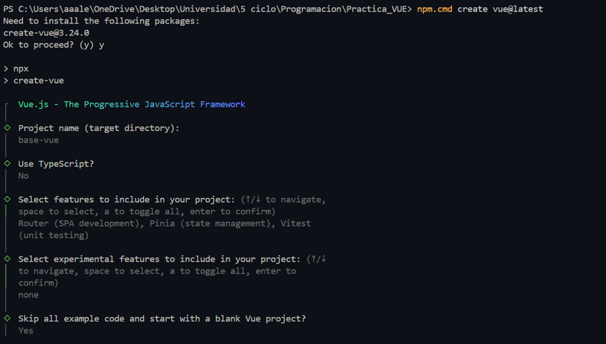

No marcamos las opciones experimentales y elegimos empezar sin código de ejemplo para agregar nuestros propios componentes.

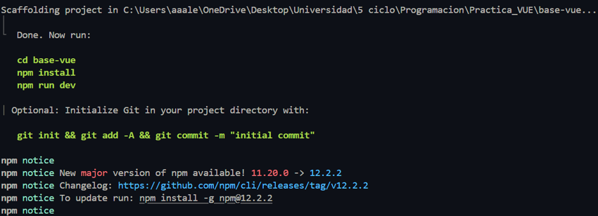

Luego pasamos los archivos a nuestra carpeta `Practica_VUE` e instalamos las dependencias:

```powershell
npm.cmd install
```

Se instalaron 231 paquetes ademas también apareció un aviso de cinco vulnerabilidades moderadas que quedaron pendientes de revisar.

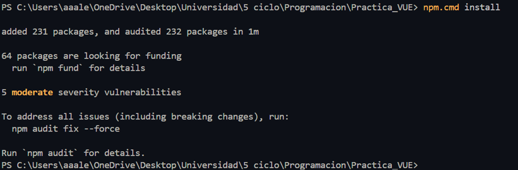

## Vite

Vite nos permite abrir el proyecto en el navegador y ver los cambios mientras trabajamos para poder realizar esta vista tenemos que iniciarlo con:

```powershell
npm.cmd run dev
```

La terminal nos mostró la dirección `http://localhost:5173/`, que abrimos para ver la página.

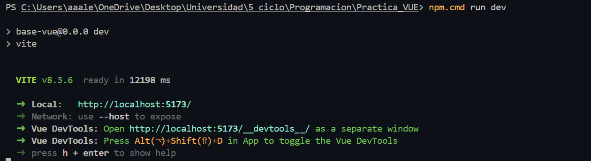

El tiempo que aparece junto a “ready” es lo que tardó en arrancar el servidor, no todo el tiempo que nos tomó configurar el proyecto.

Cuando necesitemos preparar la aplicación para publicarla, podremos usar:

```powershell
npm.cmd run build
```

## Tiempo de configuración

La configuración del proyecto nos tomó aproximadamente unos 24 minutos, incluyendo la organización de los archivos y estimamos este tiempo a partir de un cronometro.

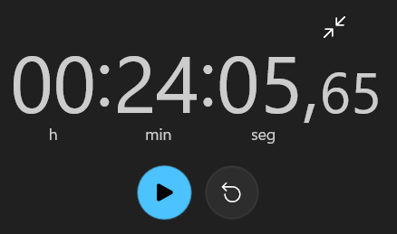

## Estructura de carpetas

Separamos los archivos para encontrar más fácil cada parte del proyecto:

- **src/componentes:** aquí van los cuatro componentes de las tareas.
- **src/estilos:** aquí está `estilos.css`, donde pondremos los colores, tamaños y diseño.
- **src/vistas:** aquí está `tareas.vue`, que será la pantalla principal.
- **docs:** aquí guardamos la investigación.
- **docs/capturas:** aquí guardamos las imágenes del proceso.

También tenemos estos archivos:

- **App.vue:** es el componente principal.
- **main.js:** inicia la aplicación y conecta las herramientas.
- **index.html:** es la página donde se muestra la aplicación.
- **package.json:** guarda las dependencias y los comandos del proyecto.
- **package-lock.json:** guarda las versiones exactas de las dependencias instaladas.

## Hola Mundo

Para comprobar que Vue funcionaba, pusimos este código en `App.vue`:

```vue
<script setup>
const saludo = 'Hola Mundo'
</script>

<template>
  <h1>{{ saludo }}</h1>
</template>
```

Creamos la variable `saludo` con el texto “Hola Mundo”. Después usamos `{{ saludo }}` para mostrar ese texto dentro de un título.

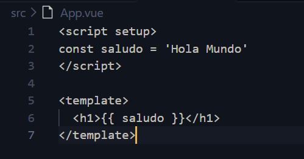

Guardamos el archivo y revisamos el navegador y al ver el mensaje “Hola Mundo” comprobamos que la aplicación estaba funcionando.

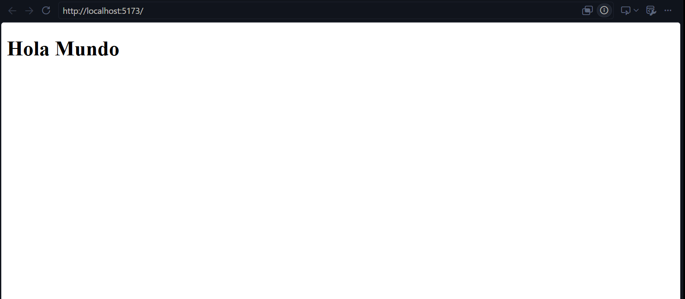

# Bloque 3: componentes, props, eventos, v-if, v-for y ciclo de vida

## Componentes

Los componentes son partes de la página que podemos usar varias veces. Nos ayudan a separar el código y no tener que escribir lo mismo para cada tarea.

En nuestro proyecto vamos a usar estos cuatro:

- **tarea_item.vue:** muestra una tarea con sus botones.
- **tarea_form.vue:** permite escribir el título de una tarea o editarlo.
- **tarea_lista.vue:** muestra las tareas.
- **tarea_filtro.vue:** permite ver todas las tareas, solo las pendientes o las completadas.

Usamos el mismo componente para mostrar las tres tareas.

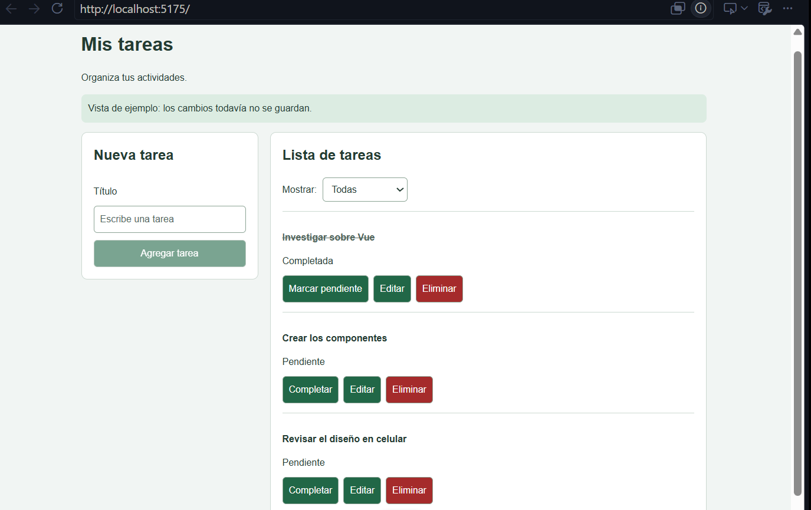

## Props

Los props permiten pasar información de un componente a otro únicamente del componente de tipo padre al componente de tipo hijo.

De ese modo la lista pasará a `tarea_item.vue` la información de cada tarea y con ello estaremos utilizando el mismo componente pero cada uno de ellos mostrará su propio título y estado.

Cada tarea tendrá un identificador `id`, un título `title` y un valor que indica si está completada `completed`.

Recibimos los datos de cada tarea mediante una prop.

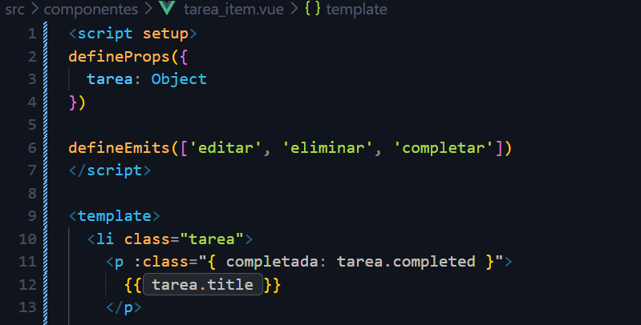

## Eventos

Los eventos permiten que un componente notifique a los demás sobre algún acontecimiento, como presionar la tecla Eliminar, enviar un formulario, etc.

Así que vamos a preparar eventos para crear, modificar, eliminar y marcar tareas como completadas en esta primera parte solo mostraremos que el aviso llega correctamente más adelante lo uniremos con Pinia y la API para efectuar los cambios.

Los componentes envían eventos y la vista muestra los datos recibidos.

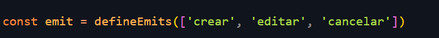

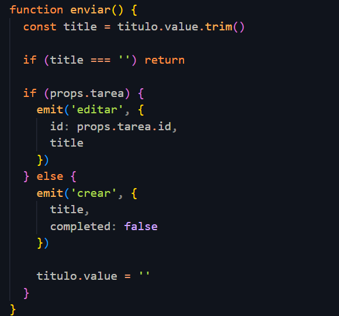

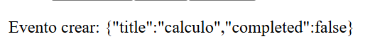

## v-if

`v-if`  sirve para mostrar algo si se cumple una condición. 

Lo utilizaremos para mostrar la lista cuando haya tareas en ella y si la lista no tiene tareas con `v-else` fijaremos que se muestre otro mensaje distinto ademas de que también servirá para poder mostrar el botón Cancelar solo cuando estemos editando.

## v-for

`v-for` sirve para recorrer una lista y repetir un elemento por cada dato.

Por esta razón utilizaremos `v-for` para mostrar las tres tareas de ejemplo sin necesidad de escribir tres veces el mismo código en si cada tarea se mostrará con el componente `tarea_item.vue` también agregaremos `:key="tarea.id"` para ayudar a Vue a poder identificar cada tarea.

Usamos v-if para comprobar si hay tareas y v-for para mostrarlas.

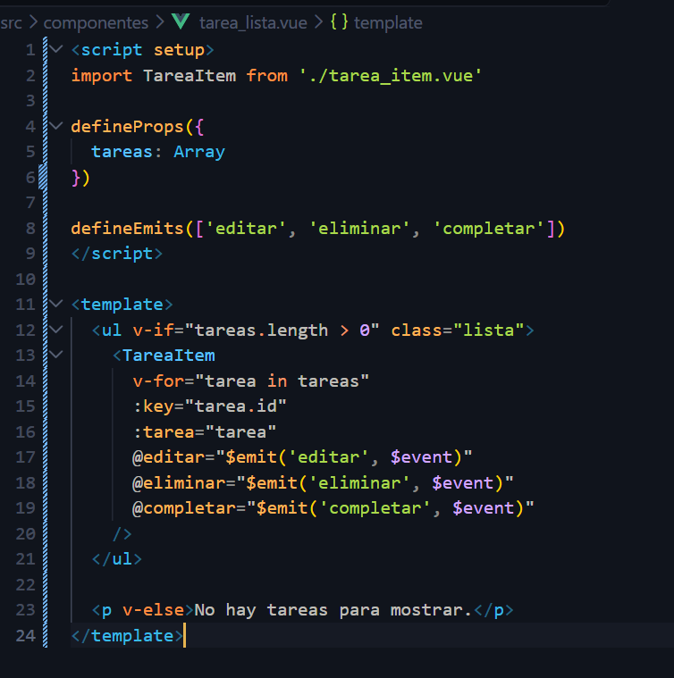

## Ciclo de vida

Un componente pasa por varias etapas las cuales son se prepara, aparece en la página, puede actualizarse y finalmente retirarse.

Vue tiene funciones que nos permiten hacer algo en esos momentos:

- **onMounted:** podemos ejecutar una acción cuando el componente ya aparece en la página.
- **onUpdated:** podemos ejecutar una acción después de que se actualiza lo que muestra el componente.
- **onUnmounted:** podemos hacer una limpieza cuando el componente se retira, como detener un temporizador.

Por ahora no necesitamos usar estas funciones, porque trabajaremos con tres tareas de ejemplo y no cargaremos datos desde una API.

# Bloque 4: Estado y reactividad en Vue

## Reactividad y `ref()`

### ¿Qué es?

La reactividad en Vue permite que la interfaz o el HTML que estamos usando, se actualice automáticamente cuando se cambian los datos de una variable que se esté usando. Para esto, Vue proporciona la función `ref()`, la cual permite crear variables o valores reactivos y detectar cuando estos cambien. A diferencia de JavaScript sin Vue, no hace falta actualizar de forma manual los elementos del HTML que se encargan de mostrar los valores de estas variables.

### ¿Para qué sirve?

`ref()` sirve para guardar valores que pueden variar a lo largo de la ejecución, como contadores, datos de formularios o listas. Se usa JavaScript para acceder y modificar el valor de esta `ref` usando `.value`, cuando se hace esto Vue actualiza automáticamente la interfaz para que muestre este nuevo valor de forma automática sin necesidad de hacerlo nosotros usando JavaScript.

### Ejemplo práctico: Cambiar el estado de una tarea

Se desarrolló un componente en Vue llamado `Ejemplo_Ref.vue`, en el cual se creó una variable reactiva `estado_tarea` utilizando `ref()`, con el valor inicial `"Pendiente"`.

Se implementó un botón que ejecuta la función `actualizar_estado_tarea()` mediante el evento `@click`. Esta función usa un `if/else` para alternar el valor de la variable entre `"Pendiente"` y `"Completada"`.

El estado se muestra en el HTML mediante `{{ estado_tarea }}`, se puede observar cómo Vue actualiza el valor en el HTML cada vez que cambia el valor de la variable reactiva, no se necesitó de JavaScript para actualizar la vista de ese valor en el HTML.

### Error que nos pasó y solución

Durante el desarrollo del ejemplo el botón no cambiaba el valor de la variable, esto pasaba porque se usó el operador: `==` en lugar del operador `=` que es el que sirve para asignar valores.

Para solucionar este error, se reemplazó `==` por `=` al cambiar el estado de la variable, esto se hizo consultando a ChatGPT, sobre el porqué el botón no funcionaba y él nos dio feedback de cuál era el problema.

### Código del ejemplo:

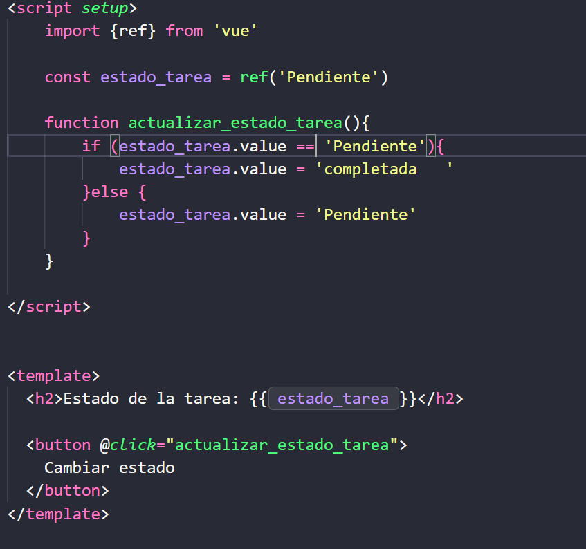

### Evidencia de funcionamiento:

**Estado inicial de la tarea:**

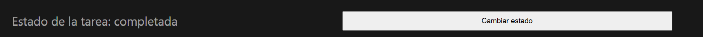

**Estado después de presionar el botón:**


### Fuente:

[Documentación oficial de Vue — Fundamentos de reactividad](https://vuejs.org/guide/essentials/reactivity-fundamentals.html)

## Estado local y global

### ¿Qué es?

El estado local consiste en tener variables, como contadores, listas o datos en sí, pero de manera local por ejemplo que si cambian de valor este cambio solo afecta al componente que los contiene es decir, si un componente tiene un contador y se instancia dos veces este componente, pues el contador de la primera instancia no será el mismo que el de la segunda.

Por otro lado un estado global consiste en que estas variables o listas, son globales es decir si se cambian sus valores todos los elementos u otros componentes que las usen pues se verán reflejados con este valor, es decir compartirán la información.

### ¿Para qué sirve?

El estado local sirve para trabajar con un componente específico en el que queremos que esa variable solo cambie en la instancia del componente que estamos usando.

En cambio el estado global es útil cuando queremos que los cambios en esa variable sean reflejados en los demás componentes que la usen, por ejemplo tenemos un contador que funciona como un reloj, hacemos que cambie su valor para que esta variable se actualice y se use en el reloj de la aplicación y en una variable que usa la hora para calcular algo, básicamente necesitan tener el mismo valor en esa variable y por ello es de estado global.

### Ejemplo práctico

Para demostrar el funcionamiento del estado global, se realizó una práctica utilizando Pinia, en la cual dos componentes diferentes acceden a una misma lista de tareas almacenada en un store.

El primer componente muestra las tareas en su orden original, mientras que el segundo las muestra en orden inverso. De esta manera, ambos utilizan la misma información compartida, pero la presentan de formas diferentes.

El código y las evidencias de esta práctica se encuentran en el siguiente apartado, **Pinia y estado compartido**.

## Pinia y estado compartido

### ¿Qué es?

Pinia es una biblioteca que se importa, básicamente permite aplicar el concepto de estado global que se vio en el punto anterior, nos permite crear una store, que básicamente es el contenedor o como un almacén de estado compartido que va a contener la variable o las variables y también funciones que cambien esa variable.

Después los componentes van a importar una función para poder acceder a la store y poder usar la variable o variables que entregue esta store, además de las funciones que tenga.

### ¿Para qué sirve?

Es muy útil y sirve para poder usar estas variables o arreglos en varios componentes que lo necesiten como el ejemplo del reloj de antes o incluso para la app de gestión de tareas cuando varios componentes necesiten acceder a cada tarea o al arreglo de tareas para cambiar sus propiedades, agregar tareas o eliminarlas.

### Ejemplo práctico: Lista de tareas compartida mediante Pinia

Se desarrolló un ejemplo utilizando Pinia para compartir un arreglo de tareas entre dos componentes diferentes de Vue.

Primero, se creó un store en el archivo `tareas.js`, utilizando `defineStore()` de Pinia y `ref()` de Vue para almacenar una lista de tareas de forma reactiva. Mediante `return { tareas }`, se permite que otros componentes puedan acceder al arreglo.

Después, se crearon dos componentes llamados `Lista_Tareas_Normal.vue` y `Lista_Tareas_Invertida.vue`. Ambos importan la función `usarTareasStore()` para acceder al mismo store.

En el primer componente se utiliza `v-for` para recorrer y mostrar las tareas en su orden original. En el segundo componente se utiliza el mismo arreglo, pero aplicando el método `toReversed()`, que permite mostrar las tareas en orden inverso sin modificar el arreglo original.

De esta forma se demuestra cómo Pinia permite que dos componentes diferentes utilicen la misma información para fines diferentes.

### Código del store de Pinia

En esta captura se muestra el archivo `tareas.js`, donde está la lista compartida.

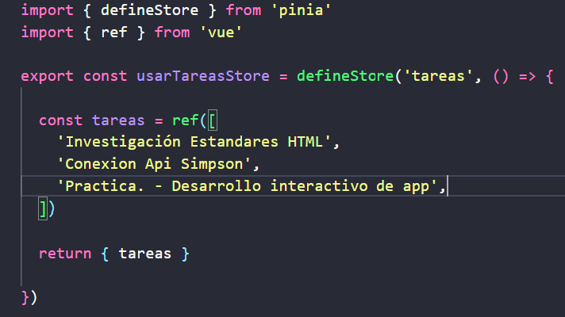

### Componentes que utilizan el store

En la siguiente captura se muestran los dos componentes, los cuales acceden al mismo store y utilizan `v-for` para mostrar las tareas en diferente orden.

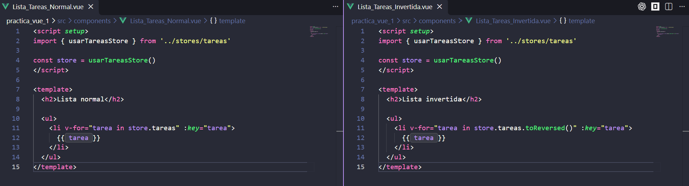

### Evidencia de funcionamiento

Como se puede observar se ven las dos listas en la pagina web, con la store creada en el momento en el que la lista dentro de la store cambie se agregue o elimine un valor, imediatamente se reflejara el cambio en las dos listas de la web

Se demuestra asi el funcionamiento de este estado global.

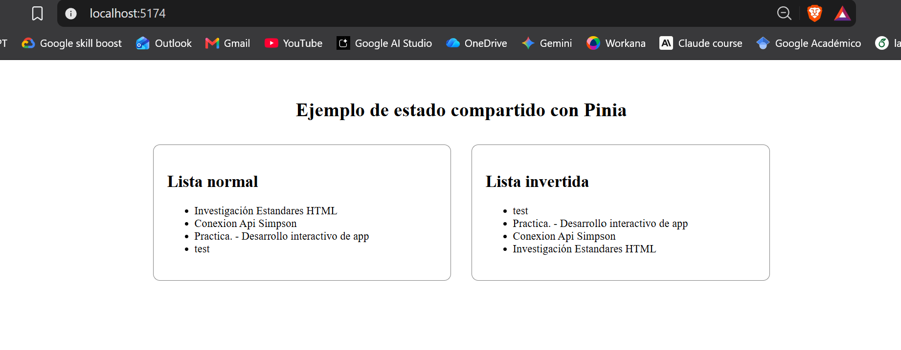

### Error que nos pasó y solución

Durante el desarrollo del ejemplo, las listas aparecían desordenadas en la página, con un fondo negro y con un orden que no se programó.

Esto ocurrió porque el proyecto Vue que utilizamos para las pruebas todavía tenía los estilos CSS que vienen por defecto como ejemplo que da Vue. Esto hacía que la presentación creada se vea diferente y desordenada.

Para solucionar el problema, se revisó el archivo `main.js` y se comentó la importación de `main.css`, así no se aplicaron estos estilos en la app.

Después de estos cambios la página web se mostró tal cual se deseaba y el ejemplo se vio bien.

### Fuentes:

[Documentación oficial de Pinia](https://pinia.vuejs.org/)

[Documentación oficial de Vue — Renderizado de listas](https://vuejs.org/guide/essentials/list.html)

# Bloque 5: Rutas y API

## Vue Router (Enrutador)

### ¿Qué es?

Un enrutador es básicamente un sistema que ayuda a gestionar la navegación entre páginas o vistas según la URL, esto ya se podía hacer con HTML normal sin Vue, pero Vue nos da la herramienta Vue Router, la cual permite crear un archivo que va a relacionar la URL con un componente en específico.

De esta forma no debemos cargar varias veces un archivo HTML, sino que cargamos el HTML principal y con Vue Router podemos cambiar entre varias páginas en las que cada página es un componente.

### ¿Para qué sirve?

Sirve para organizar mejor la página web, evitar tener varios archivos HTML y tener una organización de los enlaces con su contenido respectivo, de esta manera podemos implementar mucho mejor nuestra página web.

## Consumo de API REST con `fetch()`

### ¿Qué es?

Una API REST es básicamente una API que sigue un estilo de arquitectura llamado REST. La API en sí es la encargada de permitir la comunicación entre diferentes sistemas; en nuestro caso, el backend con el frontend. REST es un estilo o estructura que se le da a la API, que normalmente utiliza HTTP y sus diferentes métodos.

Después, `fetch()` es una funcionalidad de JavaScript que nos permite hacer solicitudes al backend mediante la API. Podemos enviar o recibir datos.

Consumir una API REST con `fetch()` es eso, usar `fetch()` para solicitar algo al backend y mediante la API obtener esos resultados que buscamos.

### ¿Para qué sirve?

Esto sirve para poder enviar u obtener datos de un backend que puede estar conectado con una base de datos o para utilizar funcionalidades que proporciona ese backend.

## Manejo de errores y estados de carga

### ¿Qué es?

El manejo de errores es básicamente eso, controlar los errores, al momento de hacer un `fetch()` puede que el servidor responda o no, o que exista una falla de red o cualquier error. Para ello usamos `try/catch`, así le podemos informar al usuario el estado de su solicitud.

De esta forma, él no verá en su pantalla errores raros o palabras que no entienda, sino que verá un mensaje claro.

Estados de carga es básicamente mostrarle al usuario una imagen o texto que le indique que su solicitud está cargando, así si el servidor tarda varios segundos, él no piensa que hizo algo mal, sino que está cargando.

### ¿Para qué sirve?

Las dos sirven para mejorar la experiencia del usuario y la estabilidad de la app en el caso de los errores. De esta forma hacemos que el usuario entienda qué está pasando.

## Ejemplo práctico: Consultar tareas usando VUE router y API REST

Para aplicar los tres conceptos vistos anteriormente, se desarrollo una app para listar las tareas desde un JSON ya sea la lista completa o por el id de la tarea.

Usamos JSON Server, este nos permite crear una API REST local a partir de un archivo `db.json`, donde se almacenaron las tres tareas con su ID, título y estado.

Para este ejemplo se utilizaron 2 rutas: `/tareas`, que muestra todas las tareas, y `/tareas/:id`, que muestra la información de una tarea segun su ID

Las consultas se hicieron usando `fetch()` y se implemento manejo de errores y estados de carga, aplicando así todos los conceptos del bloque 5.

### Configuración de Vue Router

Primero se configuró el archivo `router/index.js`, en donde se crearon las rutas, relacionando URL con el componente necesario.

La ruta `/tareas` utiliza el componente `ListaTareas.vue`, mientras que la ruta `/tareas/:id` utiliza `DetalleTarea.vue`.

Asi si el usuario le da click al link `ver detalle` le mostrara la tarea especifica, Vue Router permitira cambiar de vista y utilizar el ID de la tarea seleccionada.

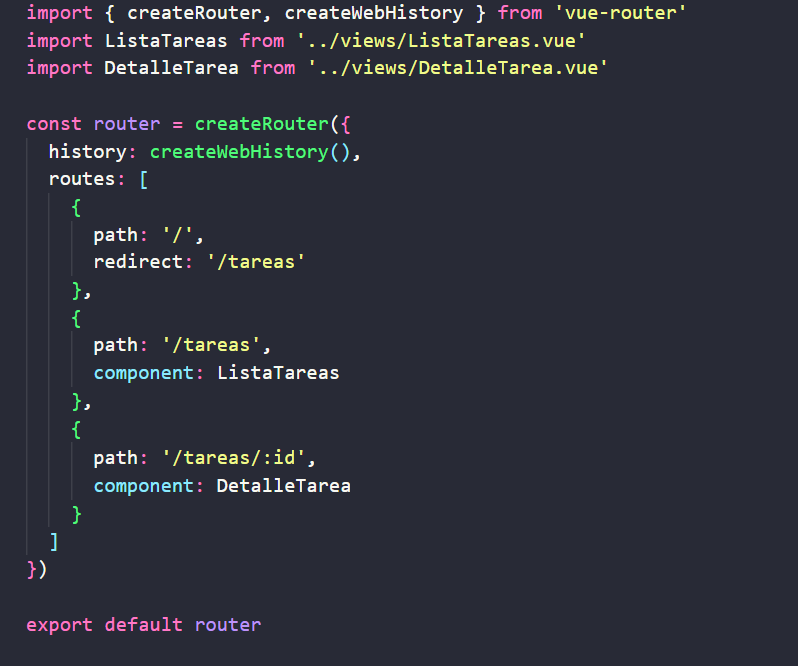

### Consumo de la API REST con fetch()

Para crear la API REST se utilizó JSON Server con el archivo `db.json`, en donde se guardaron las tareas para este ejemplo.

Después, en los componentes `ListaTareas.vue` y `DetalleTarea.vue`, se utilizó `fetch()` para hacer las solicitudes a la API.

En `ListaTareas.vue` se consulta la dirección `http://localhost:3000/tareas` para obtener todas las tareas. por otro lado, `DetalleTarea.vue` utiliza el ID recibido desde Vue Router para consultar una tarea en especifico.

Los resultados se almacenan en variables reactivas, permitiendo que Vue muestre la información de forma automatica en el HTML.

**Código de las consultas con fetch():**

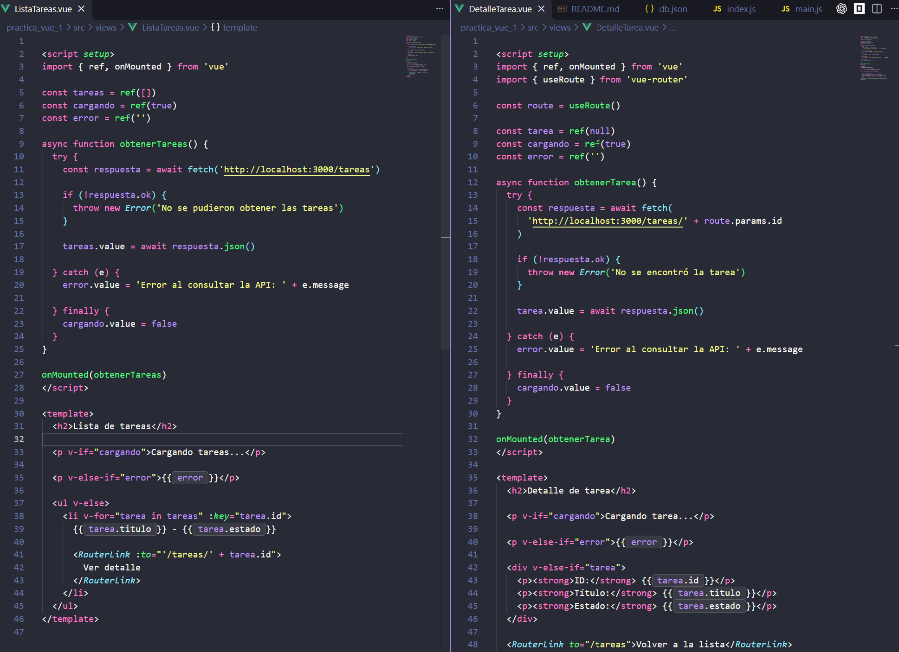

**Evidencia de la API REST funcionando:**

En la siguiente captura se puede observar cómo JSON Server devuelve las tareas almacenadas en el archivo `db.json` que creamos inicialmente.

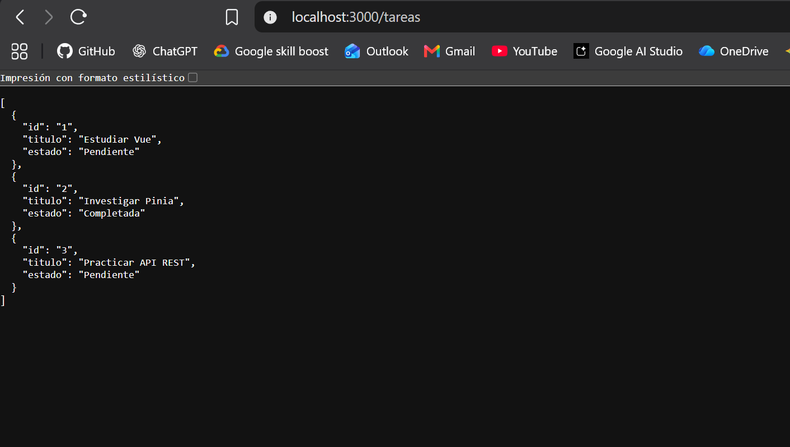

### Evidencia de funcionamiento de las rutas

**Listado de todas las tareas:**

Al ingresar a `/tareas`, se realiza una solicitud a la API y muestra las tres tareas con su título, estado y un enlace para consultar su detalle.

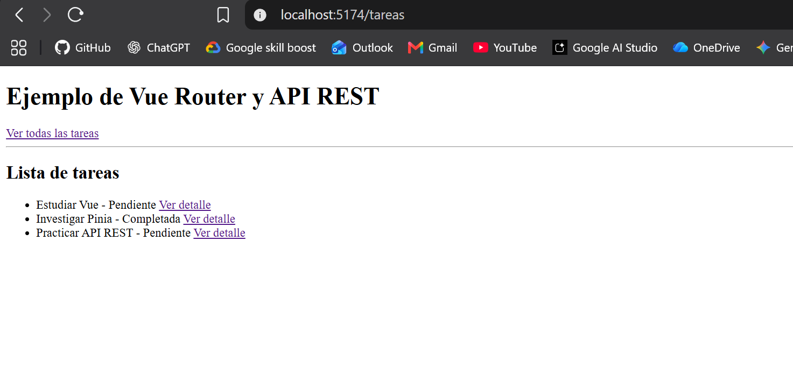

**Consulta de una tarea por ID:**

Al seleccionar «Ver detalle», Vue Router cambia a una ruta como `/tareas/1`.

En este caso, el componente `DetalleTarea.vue` utiliza `useRoute()` para obtener el ID desde la URL y realizar una nueva solicitud a la API.

Como se ve en la captura, se muestra solo la tarea con ID 1, con todos sus datos almacenados.
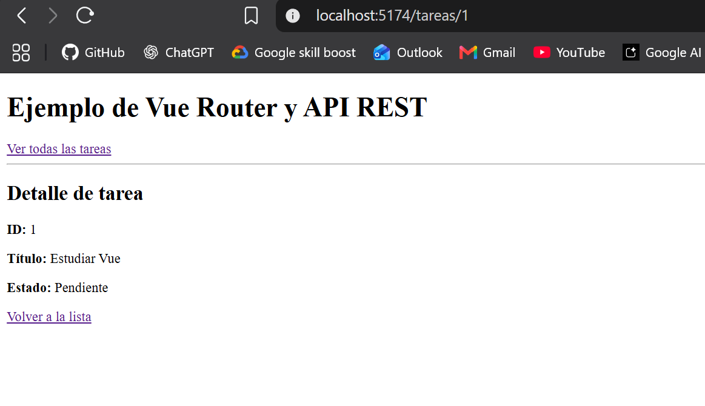

### Manejo de errores y estados de carga

Para aplicar el manejo de errores se utilizó `try/catch/finally` en las partes donde se consulta a la API.

También se comprobó `respuesta.ok` para detectar cuando el servidor devuelve una respuesta HTTP que indica un error.

Asi se valido varios de los posibles errores.

**Evidencia del estado de carga:**

Cuando se realiza una solicitud, la variable `cargando` vale `true`, por lo que Vue muestra el mensaje «Cargando tareas...».

Cuando finaliza la solicitud, el bloque `finally` cambia esta variable a `false`, haciendo que desaparezca el mensaje y se muestren o las tareas o si hay un error pues el error.

Para poder observar este estado se realizó una prueba limitando la velocidad de conexión desde las herramientas de desarrollador del navegador.

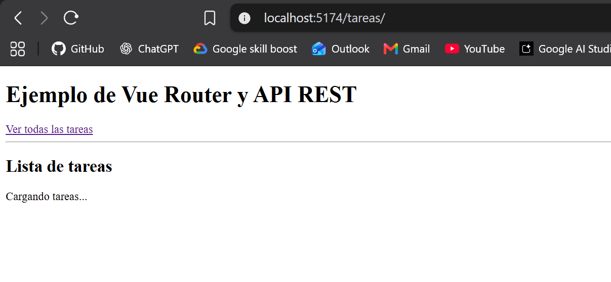

**Evidencia del manejo de errores:**

Para comprobar el manejo de errores se ingresó manualmente a la ruta `/tareas/100`, la cual no existe en nuestra API.

Al realizar la solicitud, el servidor devolvió una respuesta de error y nuestro catch mostro el mensaje correspondiente.

Como resultado, la aplicación mostró un mensaje indicando que no se encuentra la tarea

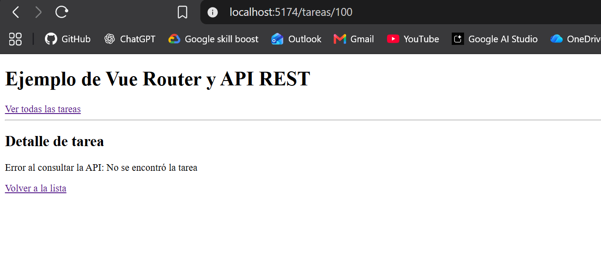

### Errores encontrados y solución

Durante el desarrollo del ejercicio no se presentaron errores importantes a tomar en cuenta o para documentar.

### Fuentes:

[Documentación oficial de Vue Router](https://router.vuejs.org/guide/)

[Documentación de MDN — Fetch API](https://developer.mozilla.org/es/docs/Web/API/Fetch_API/Using_Fetch)

[Documentación de JSON Server](https://github.com/typicode/json-server)

[Documentación oficial de Vue — Renderizado condicional](https://vuejs.org/guide/essentials/conditional.html)


# Implementación de los conceptos de los bloques 4 y 5 en la aplicación grupal

## Introducción

Después de realizar la investigación se agregaron estas funciónalidades aprendidas a la aplicación.

La aplicación ya tenía creada la interfaz principal y sus componentes, pero aún se trabajaba con un arreglo estático guardado en la vista de tareas, no se tenía la API, además los botónes para guardar, eliminar y demás aún no funciónaban.

En esta parte del informe se documentan los cambios agregados, los cuales serían el API REST que da las tareas a un store con Pinia, para que varias vistas o componentes accedan a la lista y se puedan realizar las operaciónes de crear, eliminar y demás. A parte de esto se agregaron las rutas para acceder a la lista entera o a una tarea en específico.

## 1. Implementación del store compartido con Pinia

Para administrar las tareas con sus datos se creó el archivo `src/stores/datos_tareas.js`, donde utilizamos la función `defineStore()` de Pinia.

Dentro del archivo se declaró la variable `tareas` la cual va a almacenar el arreglo de tareas que vamos a obtener directamente desde la API, esta variable era reactiva por lo que se actualiza la vista sola, además se declararon las variables `EstaCargando` y `error` para manejar errores y el estado de carga para una mejor experiencia de usuario.

De igual forma en esta clase se agregaron las funciónes necesarias para las operaciónes CRUD, básicamente agregar, eliminar, editar y cambiar el estado, esto mediante JSON Server, que es el que modifica directamente `db.json`, que es nuestra mini base de datos de tareas.

Desde las otras vistas como la de tareas y la de detalle de tareas se usará `TareasCompartidasStore()` para poder utilizar todas las funciónes del store que acabamos de crear y así conectar la interfaz con nuestra API.

### Evidencia del código de Pinia

En la captura se observa la clase store con las variables y las funciónes para obtener los datos de la API de manera general y por el ID de una tarea

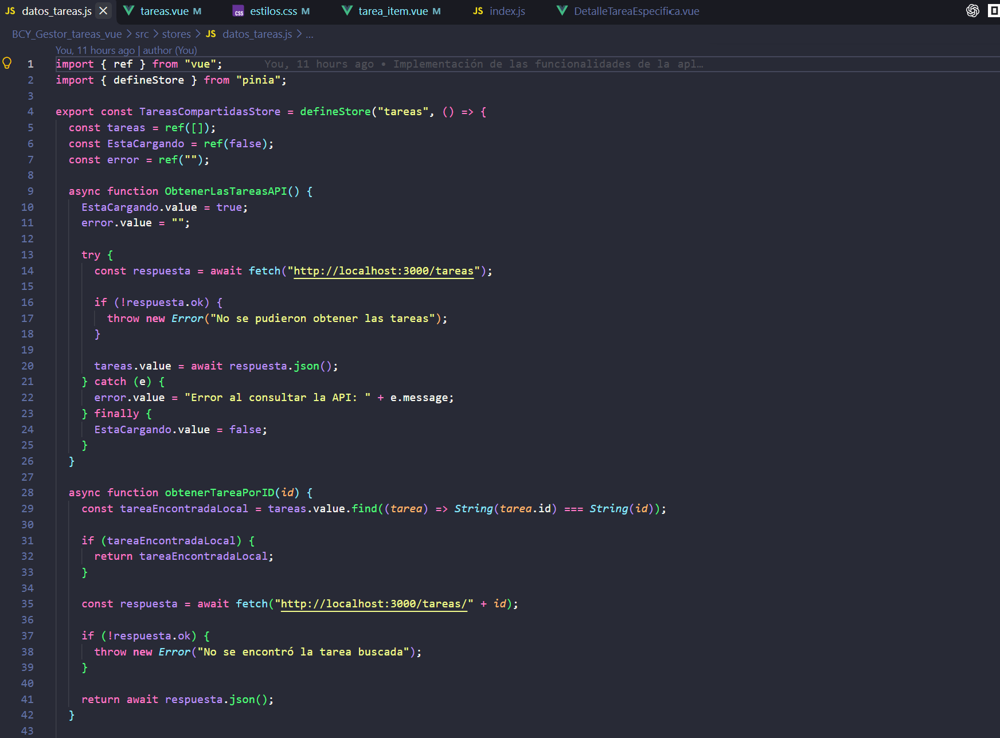

## 2. Creación y conexión de la API REST

Para trabajar con datos reales obtenidos de una API, usamos JSON Server, que permite crear una API REST local utilizando un archivo JSON.

Para ello se crea el archivo `db.json` en la carpeta principal del proyecto y se escriben en él varias tareas relacionadas con la materia.

Cada tarea tiene tres atributos, podría decirse que son:

- `id`: identificador de la tarea

- `title`: nombre de la tarea.

- `completed`: sirve para ver si está completada (`true`) o pendiente (`false`).

Para iniciar el servidor con JSON Server utilizamos el comando:
```powershell
npx.cmd json-server db.json
```

Después de iniciar el servidor, se pueden consultar las tareas en JSON desde: `http://localhost:3000/tareas`.

En el store de Pinia creamos la función `ObtenerLasTareasAPI()`, usamos un `fetch()` y mediante una solicitud de `GET` a JSON Server obtenemos las tareas del archivo JSON.

### Evidencia de la API REST

En la captura se observan las tareas que JSON Server devuelve al hacer la solicitud con fetch en formato JSON.

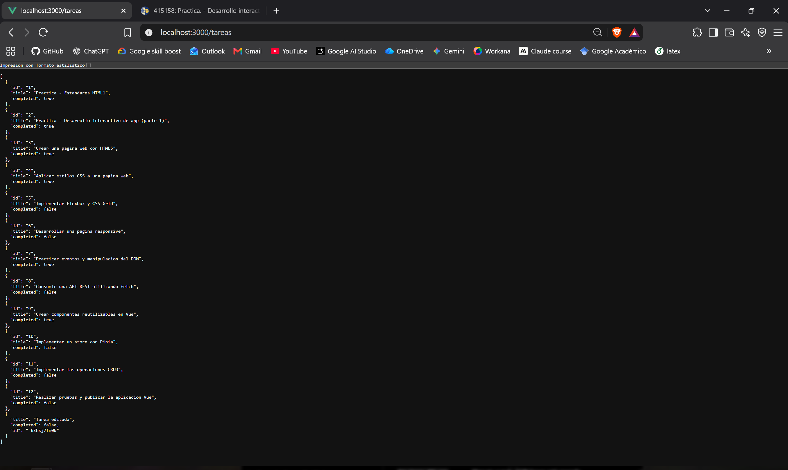

### Evidencia del listado de tareas

En la captura se observa cómo al conectar ya la API con la aplicación directamente en la vista de tareas, ya se observan las tareas obtenidas de la API.

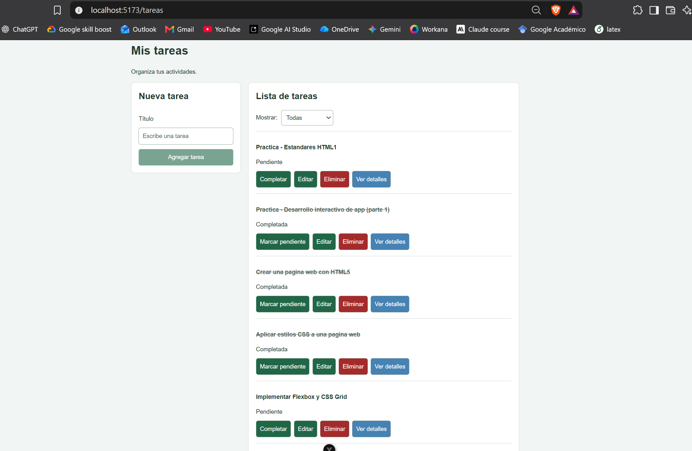

## 3. Implementación de las operaciónes CRUD

Para administrar todas las tareas según lo solicitado, se usan las operaciónes CRUD las cuales fueron programadas en la clase `datos_tareas.js` que es la clase de nuestro store ahí se programan y se envían con solicitudes HTTP a la API.

Como los componentes ya tenían conectados los botónes, solamente se conectó el evento del botón con las funciónes del store, así al darle click al botón se actualizaba `db.json` directamente.

| Operación | Método HTTP | Función de Pinia |
|---|---|---|
| Consultar tareas | GET | `ObtenerLasTareasAPI()` |
| Crear tarea | POST | `CrearTareaNueva()` |
| Editar título | PATCH | `ActualizarTareasPorID()` |
| Cambiar estado | PATCH | `CambiarEstadoEntregaPorID()` |
| Eliminar tarea | DELETE | `EliminarTareaPorID()` |

Después de cada operación realizada, se ejecuta `ObtenerLasTareasAPI()` para refrescar el listado general de tareas y obtener los datos de JSON Server y que se actualice la vista.

### 3.1. Crear una tarea

Para crear una tarea se usa el formulario que ya venía creado.

Cuando el usuario escribe un título para la tarea y presiona **Agregar tarea**, el formulario crea el evento con los datos de la nueva tarea y los envía. De esta manera en la vista principal se recibe este evento y se lo envía al store con el método `CrearTareaNueva()`, para que JSON Server guarde los datos.

Esta función utiliza un `fetch()` con el método `POST` y envía los datos a JSON Server, la cual los guarda y genera un ID para cada tarea nueva, después actualiza la lista de tareas principal.

**Evidencia de la creación de una tarea**

En la captura se observa la nueva tarea creada en el listado.

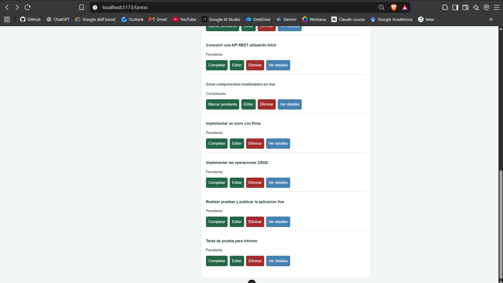

### 3.2. Editar una tarea

Para editar una tarea se usa el botón **Editar** que ya estaba implementado.

Cuando se elige una tarea para editar, se realiza el proceso programado anteriormente y se coloca en el formulario el título actual y un botón **Guardar cambios** y otro **Cancelar**, cuando se elige guardar cambios, se envía el nuevo título y el ID de la tarea.

En la vista principal se reciben los datos y se envían al método `ActualizarTareasPorID()` el cual realiza una solicitud `PATCH` a JSON Server para cambiar únicamente la propiedad `title` de la tarea y mantiene los demás elementos el ID y el estado, de igual forma al terminar se actualiza la lista y se ve el cambio.

**Evidencia de la edición de una tarea**

Se ve en la captura el formulario para editar y el resultado de la tarea editada.

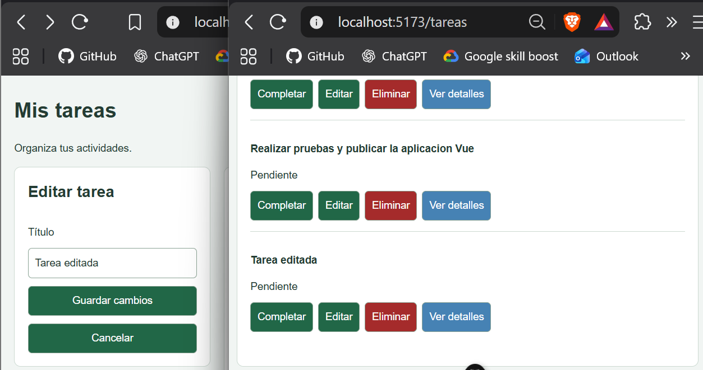

### 3.3. Cambiar el estado de una tarea

Se implementa usando la funciónalidad del botón que ya estaba creada.

Este botón nos devuelve el ID de la tarea y el valor del campo, que en este caso ya es el contrario, es decir, el que se debe enviar a la API, el campo es el de `completed`.

Desde la vista principal usamos `CambiarEstadoEntregaPorID()` y le enviamos los datos al store, Esta función envía una solicitud `PATCH` a JSON Server para cambiar solo el estado de la tarea, de igual forma se vuelve a actualizar el listado de tareas y se verifica visualmente el cambio.

**Evidencia del cambio de estado**

Se puede observar la tarea antes y después del cambio de estado.

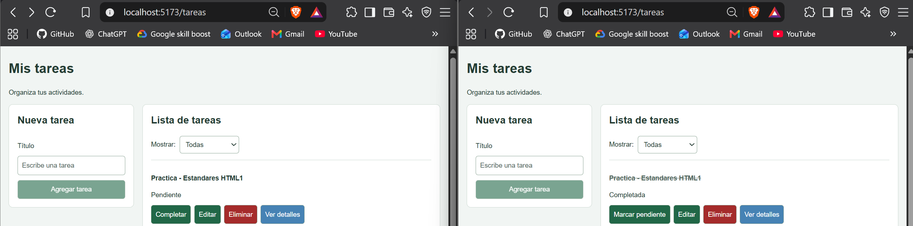

### 3.4. Eliminar una tarea

Para eliminar una tarea utilizamos el botón **Eliminar**, el cual envía el ID de la tarea a eliminar.

Desde la vista principal usamos a `EliminarTareaPorID()` función del store, esta función utiliza el método `DELETE` junto con el ID obtenido para decirle a JSON Server cuál es la tarea que debe eliminar, de igual forma se vuelve a actualizar el listado de tareas y se observa que ya no está la tarea eliminada.

**Evidencia de la eliminación de una tarea**

Se puede observar la tarea antes y después de eliminar una tarea.

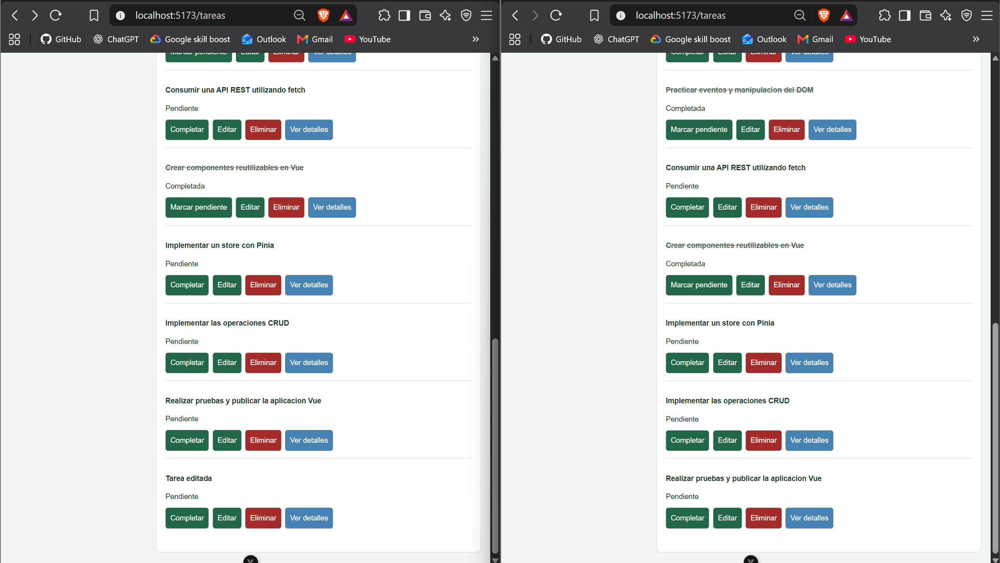

### 3.5. Código de las solicitudes HTTP

Para realizar todas las operaciónes mostradas se hacen las solicitudes a la API usando `fetch()` con los métodos `POST`, `PATCH` y `DELETE`.

En las solicitudes que envían nueva información se usa `JSON.stringify()` para convertir los datos de JavaScript a formato JSON.

**Evidencia del código CRUD**

En la captura se observan todas las funciónes que realizan las solicitudes HTTP desde la clase del store.

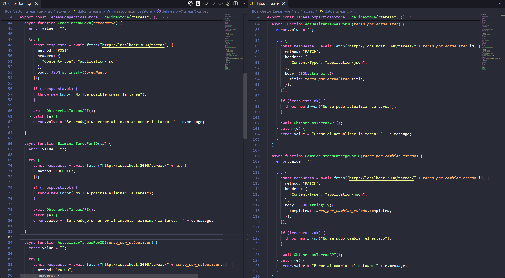

## 4. Filtros de tareas

La aplicación ya contaba con un componente para seleccionar las tareas según su estado.

Una vez se conectó con Pinia y con la API se mostraron las tareas directamente de la API.

Se usa `computed()` junto con `filter()` para obtener solamente las tareas que cumplen la condición seleccionada.

Las opciones disponibles son:

- Todas: muestra todas las tareas.

- Pendientes: muestra las tareas que tienen `completed` en `false`.

- Completadas: muestra las tareas que tienen `completed` en `true`.

### Evidencia de los filtros

En la captura se puede ver el filtro funciónando mostrando las tareas completadas o las pendientes.

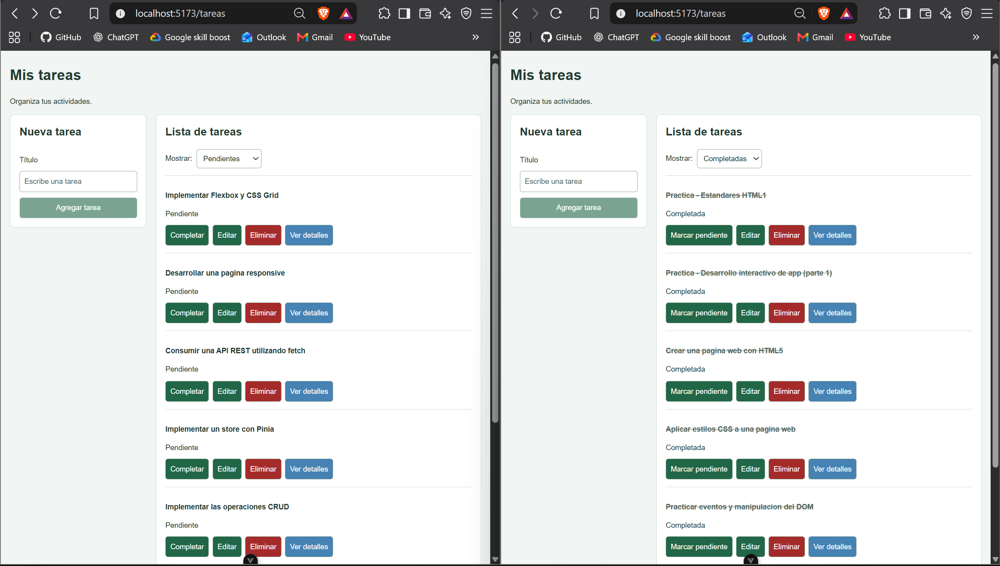

## 5. Implementación de las rutas con Vue Router

Para cumplir con lo solicitado se implementaron dos rutas para la lista completa de tareas y para cada tarea.

La aplicación ya tenía instalado y registrado el enrutador, solamente se agregó la ruta y la nueva vista para los detalles de las tareas.

En el archivo `src/router/index.js` se configuraron las siguientes rutas:

- `/`: redirige automáticamente a `/tareas`.

- `/tareas`: muestra la vista principal con la lista de tareas.

- `/tareas/:id`: muestra los detalles de una tarea específica por su ID.

También agregamos un enlace llamado **Ver detalles** dentro de cada tarea.

Este enlace construye una URL que es la URL general más el ID de la tarea.

### Evidencia de la configuración de rutas

En la captura se ve cómo configuramos las rutas usando Vue Router.

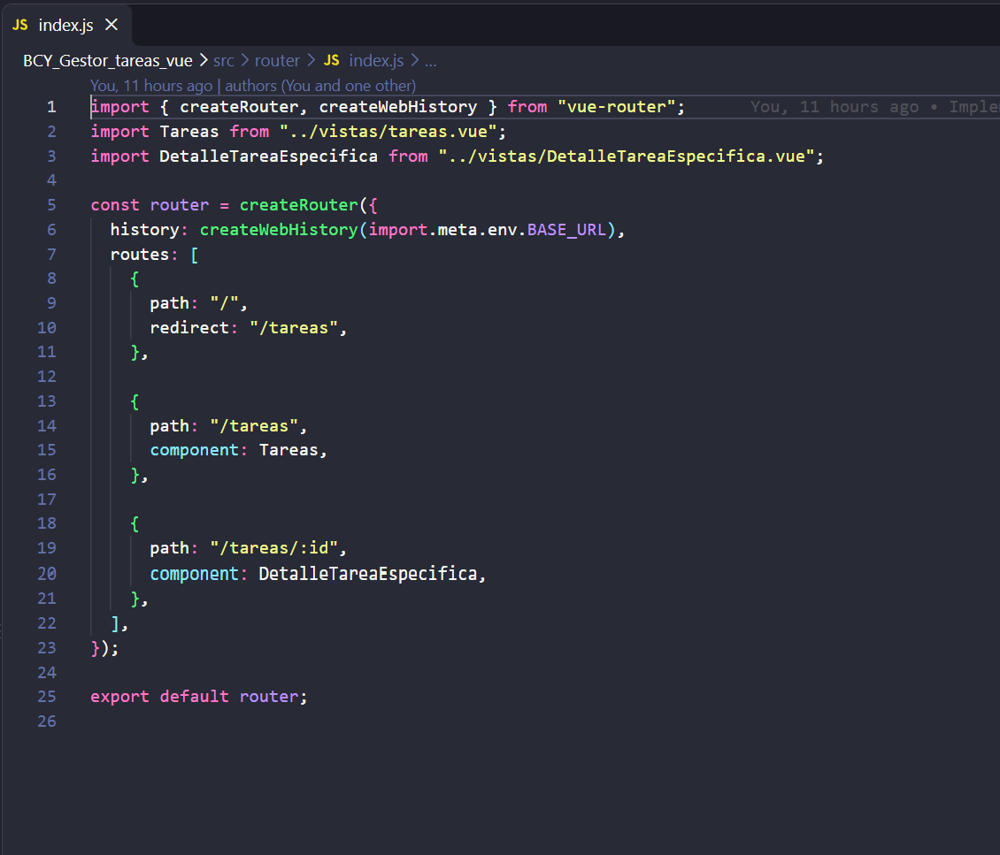

### 5.1. Vista de detalle de una tarea

Para mostrar la información de cada tarea creamos el componente `DetalleTareaEspecifica.vue`, en esta vista se usa `useRoute()` para obtener el ID directo de la dirección del navegador.

Después usamos la función `obtenerTareaPorID()` de la clase store para así obtener los datos solo de esa tarea.

La vista muestra el ID, título y estado de cada tarea y un enlace para volver al listado principal.

**Evidencia de la vista de detalle**

En la captura se observa los detalles de una tarea según su ID.

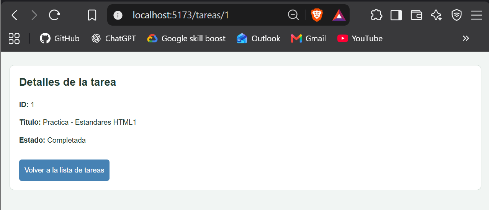

## 6. Uso del estado compartido entre las vistas

Para aprovechar el estado compartido entre vistas creamos la función `obtenerTareaPorID()`, primero utilizamos `find()` para buscar la tarea dentro del arreglo que ya obtuvimos de la API.

Si la tarea está disponible, devolvemos directamente su información, sin realizar otra solicitud a la API.

En cambio, si no la encontramos en el arreglo, utilizamos `fetch()` para hacer la consulta JSON Server mediante el ID recibido.

De esta forma aprovechamos el arreglo obtenido al inicio y si no está cargado hacemos la consulta a JSON Server.

Así, tanto la vista principal como la vista de detalle pueden acceder al mismo store para trabajar con las tareas.

## 7. Manejo de carga y errores

Para controlar las solicitudes HTTP utilizamos `try/catch/finally`.

Con `try` se consultan los datos y con `catch` capturamos los errores que pueden ocurrir. Finalmente, con `finally` actualizamos la variable `EstaCargando` para verificar si ya llegaron los datos.

También en un if validamos `respuesta.ok` para detectar cuando la API devuelve un error HTTP.

Durante las pruebas verificamos el funciónamiento de los mensajes de error en dos situaciones.

### 7.1. Consultar una tarea inexistente

Primero se intenta acceder a una tarea con un ID inexistente, la API no lo encuentra y nos indica que no existe la tarea.

Esto es útil para que el usuario sepa qué pasa.

**Evidencia de tarea inexistente**

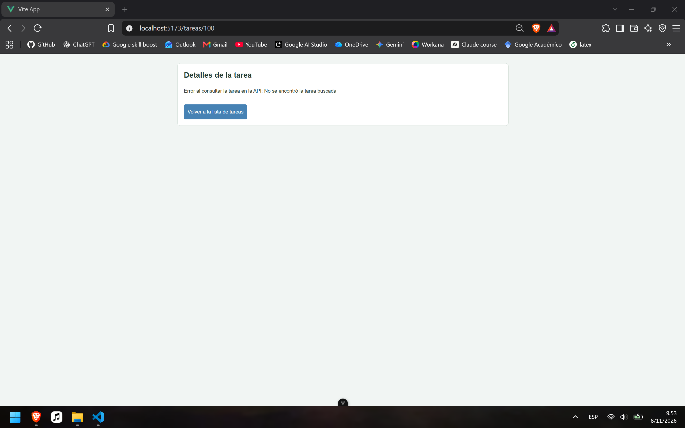

### 7.2. Intentar consultar la API cuando está apagada

Para esta prueba apagamos JSON Server, al no tener de dónde obtener las tareas, la aplicación muestra el mensaje de que no se puede conectar con la API.

De esta forma el usuario sabe que está pasando.

**Evidencia del error de conexión**

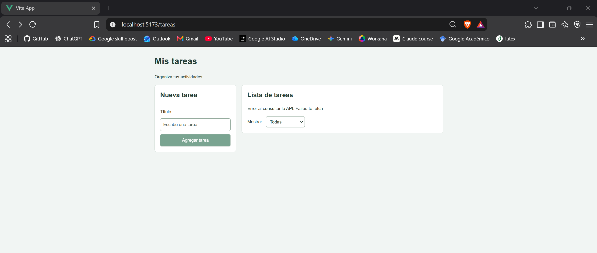

## 8. Compilación de la aplicación

Después de implementar todas las funciónalidades se ejecuta el comando de Vite para tener la versión de la app para producción.
```powershell
npm.cmd run build
```

El comando procesó los archivos del proyecto y generó una carpeta llamada `dist`, que contiene los archivos preparados para publicar la aplicación.

Con todo comprimido y sin errores según el resultado del comando, quedando lista la versión generada para la siguiente etapa del proyecto.

### Evidencia de la compilación

En la captura se muestra la salida del comando: `npm.cmd run build`.

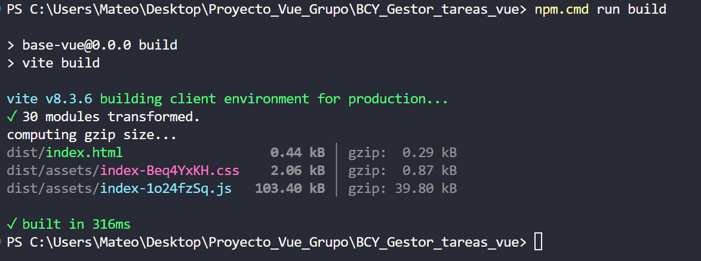

Finalmente se implementaron de manera satisfactoria todos estos cambios y funciónalidades explicadas anteriormente. El proyecto está listo para la última fase de tests y el despliegue

# Bloque 6: Pruebas unitarias con Vitest

## ¿Qué son las pruebas unitarias y Vitest?

Las pruebas unitarias sirven para comprobar que cada parte o componente de nuestra aplicación funcione correctamente de manera aislada antes de publicar el proyecto. 

Para esto usamos **Vitest** junto con **`@vue/test-utils`**, que son las herramientas oficiales recomendadas en Vue 3 para montar componentes en un entorno de pruebas, simular clics o escritura del usuario y verificar que el componente responda o emita los eventos esperados sin tener que probar todo manualmente en el navegador.

## Implementación de las 3 pruebas unitarias

Creamos el archivo `src/__tests__/App.spec.js` donde programamos 3 pruebas unitarias para evaluar los componentes `tarea_item.vue` y `tarea_form.vue`:

1. **Prueba 1 (Renderizado de datos por props):** Montamos el componente `tarea_item.vue` pasándole una tarea de ejemplo (`Practica - Estandares HTML`) con estado pendiente (`completed: false`). Usamos un `stub` para `RouterLink` y comprobamos con `expect()` que el título y el estado «Pendiente» se muestren correctamente en pantalla sin tener la clase `completada`.
2. **Prueba 2 (Emisión del evento completar):** Simulamos el clic del usuario en el botón de completar dentro de `tarea_item.vue` usando `trigger('click')`. Verificamos que el componente emita el evento `completar` enviando el ID de la tarea y el estado booleano invertido (`{ id: '1', completed: true }`).
3. **Prueba 3 (Creación de tarea desde el formulario):** Montamos el componente `tarea_form.vue`, simulamos que el usuario escribe `'Realizar pruebas con Vitest'` en el campo `#titulo` con `setValue()` y enviamos el formulario con `trigger('submit.prevent')`. Comprobamos que se emita el evento `crear` con los datos exactos de la nueva tarea (`{ title: 'Realizar pruebas con Vitest', completed: false }`).

### Código de las pruebas implementadas

En la siguiente captura se muestra el código completo de las tres pruebas unitarias dentro de `src/__tests__/App.spec.js`:

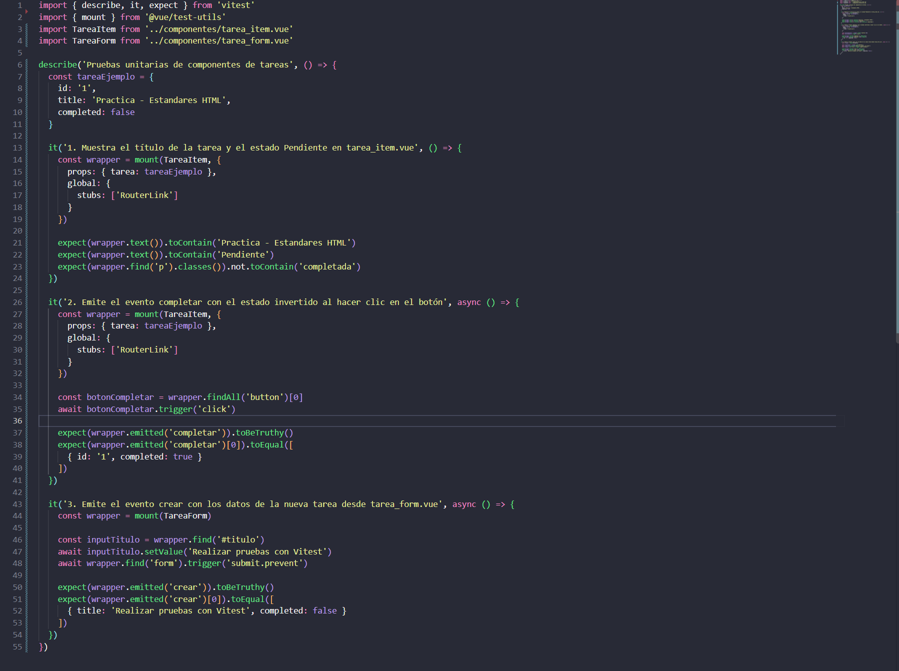

## Error que nos pasó y solución

Al principio intentamos ejecutar las pruebas directamente con el comando `npx.cmd vitest run`, pero la terminal nos arrojó el error `ERR_MODULE_NOT_FOUND: Cannot find package 'vitest'` y avisos de importaciones no resueltas en `vite.config.js` y `vitest.config.js`.

Esto pasó porque faltaba terminar de enlazar los paquetes de pruebas en `node_modules` y ejecutar el script configurado del proyecto. Para solucionarlo verificamos la instalación con `npm.cmd install` y ejecutamos las pruebas mediante el comando oficial definido en `package.json`:

```powershell
npm.cmd run test:unit
```

### Evidencia del error inicial

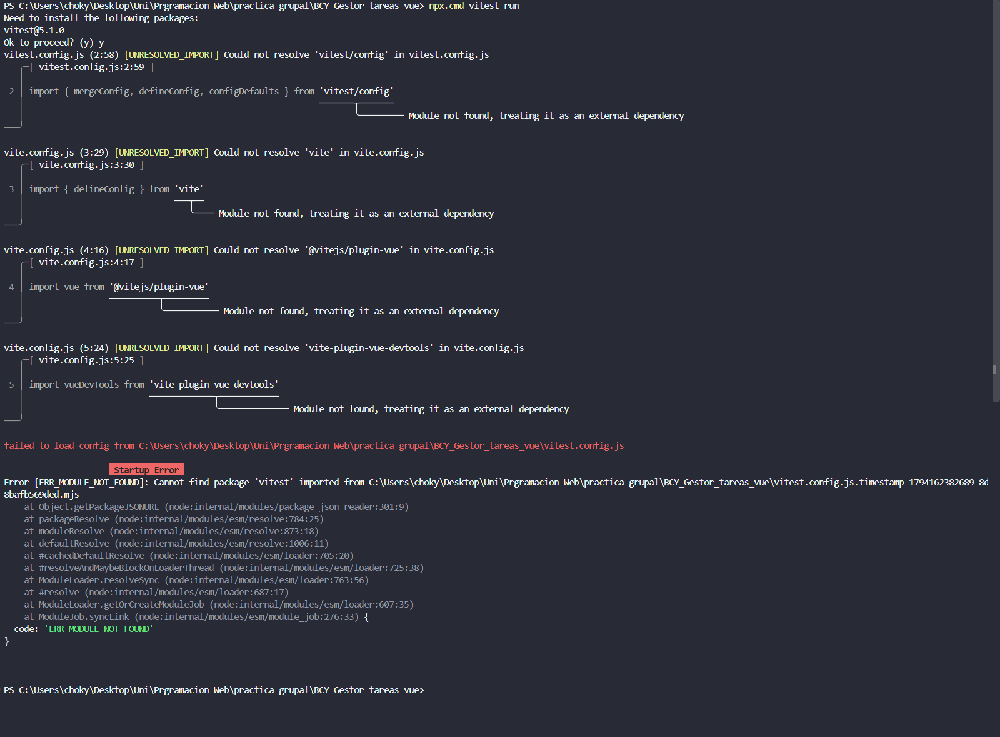

### Evidencia de las pruebas pasando correctamente

Una vez solucionado el problema, Vitest ejecutó el archivo `src/__tests__/App.spec.js` y las 3 pruebas pasaron satisfactoriamente (`3 passed`):

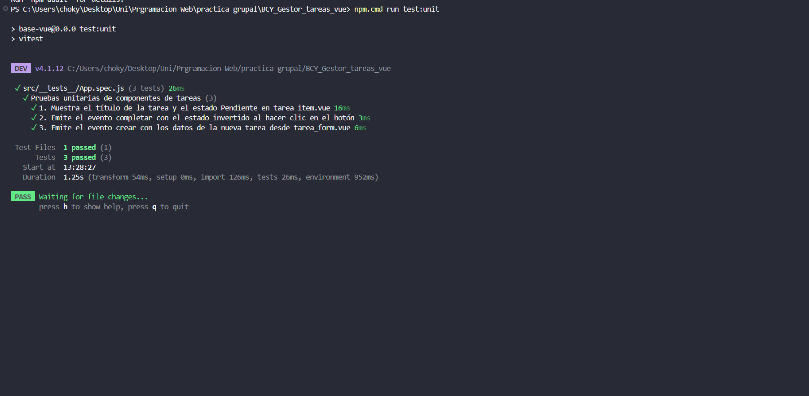

### Fuentes:

[Documentación oficial de Vitest](https://vitest.dev/guide/)

[Documentación oficial de Vue Test Utils](https://test-utils.vuejs.org/guide/)

# Bloque 7: Despliegue, métricas del proyecto y rendimiento

## 1. Preparación de la API en la nube y rutas para producción

Como en los bloques anteriores trabajamos con `JSON Server` de forma local (`http://localhost:3000`), al subir la página a internet no iba a poder conectarse a la computadora local.

Para solucionarlo creamos una API REST gratuita en la nube usando **MockAPI.io** con el recurso `tareas`, poblada con las 12 tareas oficiales del proyecto académico y los mismos campos (`id`, `title`, `completed`). Después actualizamos el archivo `src/stores/datos_tareas.js` para que use la variable de entorno `VITE_API_URL`:

```javascript
const API_BASE = import.meta.env.VITE_API_URL || "http://localhost:3000";
```

De esta manera, en desarrollo local puede seguir usando `localhost:3000` y en producción se conecta automáticamente a nuestra API en la nube (`https://6af0c20a11a6aa866e7fbf30.mockapi.io/api/v1`).

Además, como nuestra aplicación usa **Vue Router** (Single Page Application), agregamos los archivos `vercel.json` y `public/_redirects` redirigiendo las rutas a `/index.html`. Con esto evitamos que salga error `404` cuando el usuario recarga la página estando en `/tareas` o en `/tareas/:id`.

## 2. Compilación a producción (`build`) y conteo de líneas de código

Antes de desplegar, generamos la versión optimizada de producción con el comando:

```powershell
npm.cmd run build
```

Vite empaquetó y comprimió los 30 módulos de la aplicación en 106 ms dentro de la carpeta `dist`.

### Evidencia del build en terminal

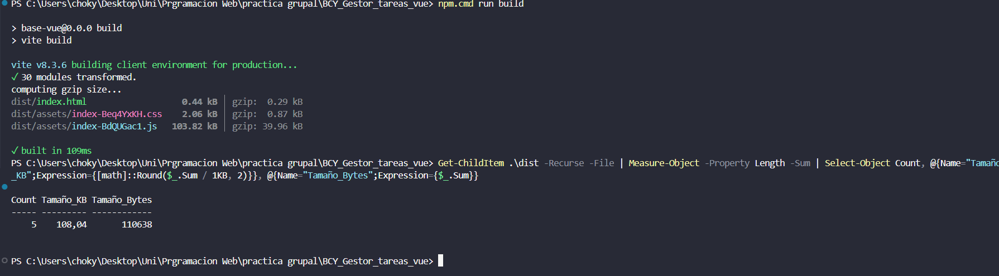

Posteriormente medimos las líneas de código de la carpeta `src` utilizando la herramienta `sloc` en la terminal:

```powershell
npx.cmd sloc src
```

### Evidencia del conteo de líneas de código

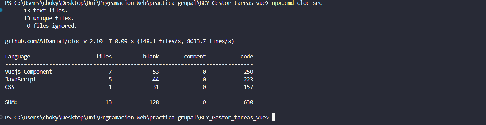

## 3. Despliegue en Vercel y auditoría con Lighthouse

Desplegamos la aplicación en **Vercel** vinculando nuestro proyecto mediante Vercel CLI. La aplicación quedó publicada y funcionando en tiempo real en los siguientes enlaces:

- **URL principal de producción:** [https://bcy-gestor-tareas-vue.vercel.app](https://bcy-gestor-tareas-vue.vercel.app)
- **URL de despliegue en Vercel:** [https://bcy-gestor-tareas-kd5k24zry-michael-b6ba.vercel.app/tareas](https://bcy-gestor-tareas-kd5k24zry-michael-b6ba.vercel.app/tareas)

Una vez publicada, abrimos la aplicación desplegada y ejecutamos la auditoría de **Lighthouse** desde las herramientas de desarrollador de Google Chrome para medir el rendimiento real.

### Evidencia de Lighthouse en producción

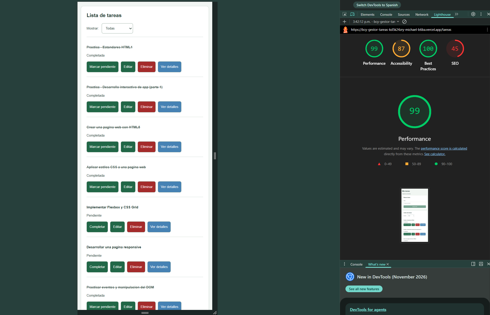

## 4. Tabla resumen de métricas del proyecto

En la siguiente tabla se resumen todas las mediciones obtenidas de nuestra aplicación en Vue 3:

| Métrica | Resultado | Detalle |
|---|---|---|
| **Archivos analizados en `src/`** | 13 archivos | Componentes, vistas, router, store, estilos y pruebas |
| **Líneas físicas totales** | 728 líneas | Incluye código, comentarios y líneas en blanco |
| **Líneas de código reales (SLOC)** | 595 líneas | Líneas netas de código fuente en `src/` |
| **Tiempo de compilación (`build`)** | 106 ms | 30 módulos transformados con Vite v8.3.6 |
| **Tamaño del HTML (`dist/index.html`)** | 0.44 kB (gzip: 0.29 kB) | Archivo raíz de la aplicación |
| **Tamaño del CSS (`dist/assets/*.css`)** | 2.06 kB (gzip: 0.87 kB) | Estilos empaquetados y minificados |
| **Tamaño del JS (`dist/assets/*.js`)** | 103.36 kB (gzip: 39.85 kB) | Incluye Vue 3, Vue Router, Pinia y lógica de la app |
| **Tamaño total del build (`dist/`)** | 105.86 kB (gzip: 41.01 kB) | Peso total descargado por el navegador |
| **Pruebas unitarias (Vitest)** | 3 passed (1.25 s) | 100% de pruebas aprobadas en `App.spec.js` |
| **Lighthouse - Performance** | 99 / 100 | Carga casi instantánea en producción sobre Vercel |
| **Lighthouse - Accessibility** | 87 / 100 | Botones, formularios y estructura accesible |
| **Lighthouse - Best Practices** | 100 / 100 | Uso de HTTPS y buenas prácticas de desarrollo web |
| **Lighthouse - SEO** | 45 / 100 | Aplicación SPA enfocada en gestión interna de tareas |

# Declaración de uso de Inteligencia Artificial

Durante el desarrollo de este trabajo grupal nos apoyamos en herramientas de Inteligencia Artificial (ChatGPT y Gemini) como soporte de consulta y depuración:

- **Consultas realizadas:** resolución del error de asignación (`==` por `=`) en el ejercicio de reactividad, solución al error de carga de módulos de Vitest (`ERR_MODULE_NOT_FOUND`), uso de `stubs` para `RouterLink` en las pruebas unitarias, configuración de la variable de entorno `VITE_API_URL` con MockAPI y reglas de redirección para el despliegue en Vercel.
- **Revisión y validación:** todo el código sugerido fue probado, adaptado a los nombres de nuestras variables y componentes, ejecutado en nuestras computadoras y verificado mediante pruebas locales y en producción antes de subirlo al repositorio.